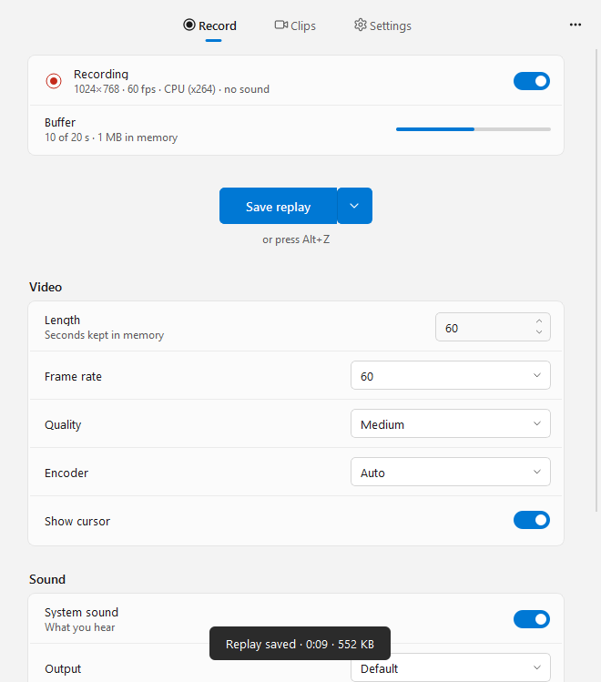
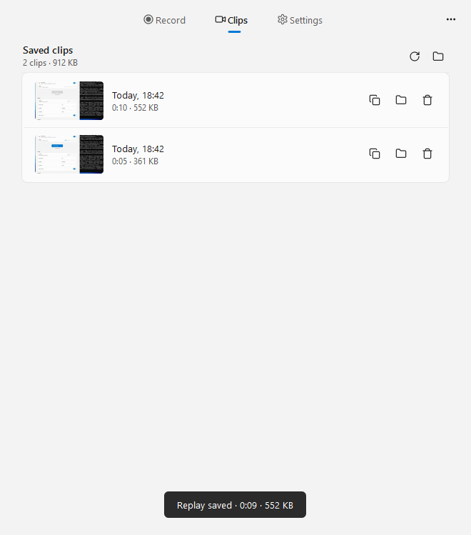
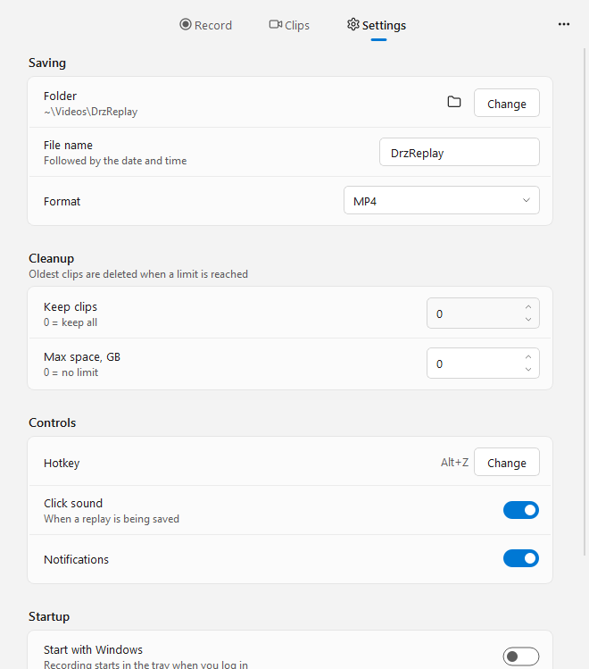
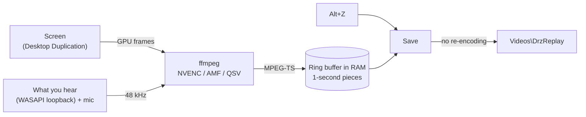

<div align="center">


# DrzReplayWIN

**Instant replay for Windows.** Your screen is always recorded into memory —
press **Alt+Z** and the last minute becomes a video file.

[](https://github.com/upidddd/drzreplaywin/releases/latest)
[](https://github.com/upidddd/drzreplaywin/releases)
[](#requirements)
[](LICENSE)

Open **PowerShell** and paste:

```powershell
irm https://github.com/upidddd/drzreplaywin/releases/latest/download/install.ps1 | iex
```

or download [**DrzReplayWIN-Setup.exe**](https://github.com/upidddd/drzreplaywin/releases/latest/download/DrzReplayWIN-Setup.exe)

  

</div>

## Why

Something great happened in a game, a call or on stream — and you weren't recording.
DrzReplayWIN is always recording, but only in memory, so nothing piles up on your disk.
When you want to keep the moment, one key saves it.

The Windows twin of [DrzReplay for Linux](https://github.com/upidddd/drzreplay).

## Features

- **Always on, never in the way.** The screen is grabbed and compressed by the graphics card
  (NVIDIA NVENC, AMD AMF or Intel Quick Sync), so games keep their FPS.
  The last minute lives in RAM, the disk is only touched when you save.
- **Instant saves.** A clip is cut from memory without re-encoding — it's on disk in a second.
- **Intro.** Optionally, *REPLAY #12* and the date slide out in the top-left corner for the first
  couple of seconds of every replay. No sound. (With the intro on, the clip is encoded again on the
  graphics card, which takes a few seconds.)
- **One key.** Alt+Z (or any key you pick) works everywhere, including fullscreen games.
  Press it twice and you get two clips — nothing is lost.
- **No repeats.** A replay empties the buffer: if 15 seconds passed since the last replay, the next one
  saves just those 15 s, not the whole minute again (can be turned off in Settings).
- **Full recordings too.** Alt+R starts recording a whole video, Alt+R again stops it. It uses the same
  encoder, so it costs nothing extra, and the file is ready a moment after you stop.
- **Sound.** What you hear (any output device, follows you when you plug in headphones)
  and your microphone, each with its own volume.
- **Clips tab.** Thumbnails, length and size of every clip. Click to play, **drag a clip
  straight into Discord or Telegram**, copy it, show it in Explorer or move it to the Recycle Bin.
- **Clean up by itself.** Keep only the last N clips or at most N GB.
- **Updates.** When a new version is out you get a notification and an *Update* button;
  one click installs it and the recorder comes back by itself.
- **Light and dark**, following your Windows theme.

## Install

```powershell
irm https://github.com/upidddd/drzreplaywin/releases/latest/download/install.ps1 | iex
```

Paste it into PowerShell (Start → type *PowerShell* → Enter). It downloads the latest release
and installs it for your user — no admin rights. DrzReplayWIN opens and starts recording right away;
from then on it starts with Windows and sits in the tray.

- **Update:** press *Update* in the app (or in the tray menu), or run the same command again.
  Settings and clips are kept.
- **Setup file:** download `DrzReplayWIN-Setup.exe` from
  [Releases](https://github.com/upidddd/drzreplaywin/releases). If Windows says
  *"Windows protected your PC"*, click **More info → Run anyway** (the app isn't code-signed).
- **Portable:** `DrzReplayWIN-portable.zip` — unpack anywhere and run `DrzReplayWIN.exe`.
- **Uninstall:** Settings → Apps → Installed apps → DrzReplayWIN → Uninstall.

### Requirements

- Windows 10 or 11, 64-bit
- Any graphics card. Without NVENC / AMF / Quick Sync the CPU encoder (x264) is used.

## Using it

| | |
|---|---|
| **Alt+Z** | save the last minute (length is set on the Record tab) |
| **Alt+R** | start / stop recording a full video |
| **Tray icon** | click: open the window · right click: save, start / stop recording, pause, folder, quit · middle click: save |
| **Close button** | hides the window, recording goes on in the tray |

Clips go to `Videos\DrzReplay` as `DrzReplay 2026-11-02 17-20-10.mp4`.

## How it works



1. ffmpeg grabs the screen with the Desktop Duplication API (`ddagrab`) and hands the frames straight
   to the hardware encoder without copying them to the CPU. The stream comes back to the app through a pipe.
2. The app keeps the stream in memory, cut at keyframes into one-second pieces; the oldest piece is
   dropped, so memory use stays flat.
3. Sound is captured with WASAPI loopback and the microphone, mixed, and fed to ffmpeg at a steady
   pace — when nothing plays, silence is filled in, so sound and picture stay in sync.
4. On save, the newest pieces are joined and written as MP4 without re-encoding.

## Troubleshooting

<details>
<summary><b>The hotkey does nothing</b></summary>

- Settings → Controls shows *Not working* next to the hotkey when another program owns it.
  Pick a different key there.
- The **NVIDIA app / GeForce Experience overlay also uses Alt+Z**. Either turn its overlay hotkey off
  or give DrzReplayWIN another key (for example Alt+X or F9).
</details>

<details>
<summary><b>No sound in clips</b></summary>

Record tab → Sound: make sure *System sound* is on and *Output* is the device you listen to
(*Default* follows Windows). If sound capture keeps failing, the recorder continues without
sound and the Record tab says *no sound*.
</details>

<details>
<summary><b>Black video</b></summary>

- Protected video (Netflix in some browsers and so on) is black in every screen recorder.
- On a laptop with two graphics cards, choose the screen on the Record tab and try another encoder;
  window menu → *Detect graphics card again* after driver updates.
</details>

<details>
<summary><b>The game stutters while recording</b></summary>

Check that the encoder on the Record tab says *NVIDIA NVENC*, *AMD AMF* or *Intel Quick Sync*.
With *CPU (x264)*, lower the frame rate to 30 and the quality to *Low* or *Medium*.
</details>

<details>
<summary><b>Logs</b></summary>

Window menu (⋯) → *Recorder log*. Files live in `%LOCALAPPDATA%\DrzReplayWIN`,
settings in `%APPDATA%\DrzReplayWIN\config.json`.
</details>

## Command line

```
DrzReplayWIN.exe                  open the window
DrzReplayWIN.exe save             save a replay now
DrzReplayWIN.exe record           start / stop recording a full video
DrzReplayWIN.exe --background     start in the tray only
DrzReplayWIN.exe quit             stop recording and close
```

## Project layout

```
src/drzreplaywin/
├── __main__.py        command line, single instance
├── core/              settings, paths, screen / encoder probing, autostart, update check
├── recorder/          ffmpeg recorder, in-memory ring buffer, sound capture, hotkey
├── ui/                window (Record / Clips / Settings), tray, theme, self-test
└── assets/            icons, click sound
packaging/
├── DrzReplayWIN.spec  PyInstaller build
├── DrzReplayWIN.iss   Inno Setup installer
└── install.ps1        the one-line installer
.github/workflows/     builds, tests on Windows and publishes releases
tools/make_icons.py    renders the .ico from the .svg
```

## Building

Every push is built and tested on Windows by GitHub Actions: it records the screen, saves a clip,
presses the hotkey and takes the screenshots above. Pushing a `v*` tag publishes a release.

Locally on Windows:

```powershell
pip install -r requirements.txt pyinstaller
# put ffmpeg.exe into build\ffmpeg\
python packaging/version_info.py
pyinstaller --noconfirm --distpath dist --workpath build/pyi packaging/DrzReplayWIN.spec
iscc packaging/DrzReplayWIN.iss      # -> dist\DrzReplayWIN-Setup.exe
```

Run from source: `set PYTHONPATH=src` and `python -m drzreplaywin` (needs `ffmpeg` on the PATH).

## Credits

FFmpeg ([GPL](https://ffmpeg.org/legal.html), builds by [BtbN](https://github.com/BtbN/FFmpeg-Builds)),
Qt / PySide6 (LGPL), PortAudio via PyAudioWPatch, Pillow. Click sound "Mechanical Sounds" by Brian MacIntosh (CC0).
Fonts Oswald and Inter (SIL OFL).
Icons after [Lucide](https://lucide.dev) (ISC). Details in
[`src/drzreplaywin/assets/CREDITS.txt`](src/drzreplaywin/assets/CREDITS.txt).

Code: [MIT](LICENSE).
